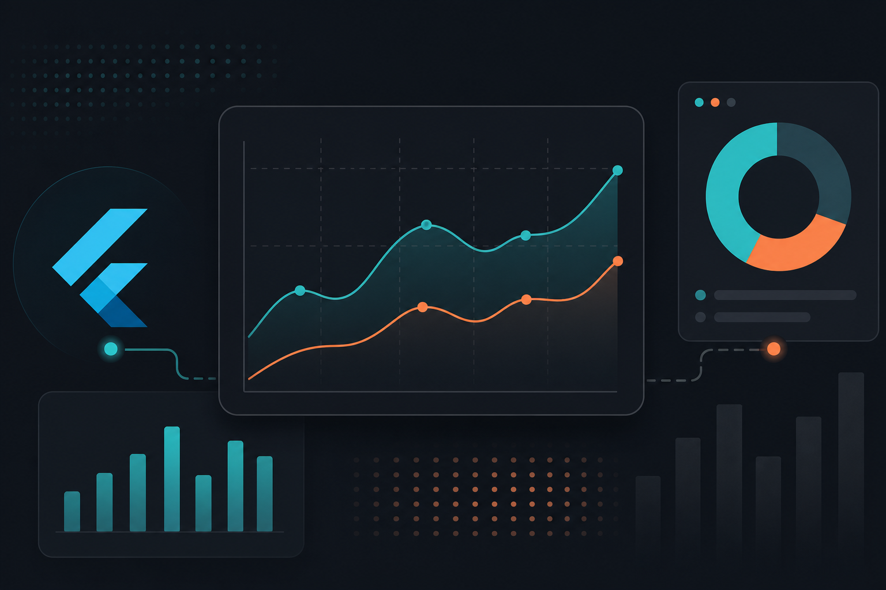
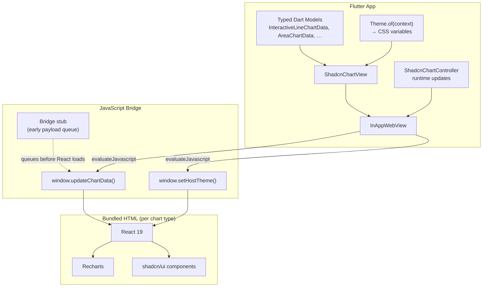
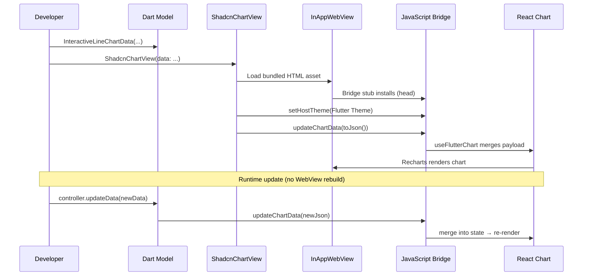
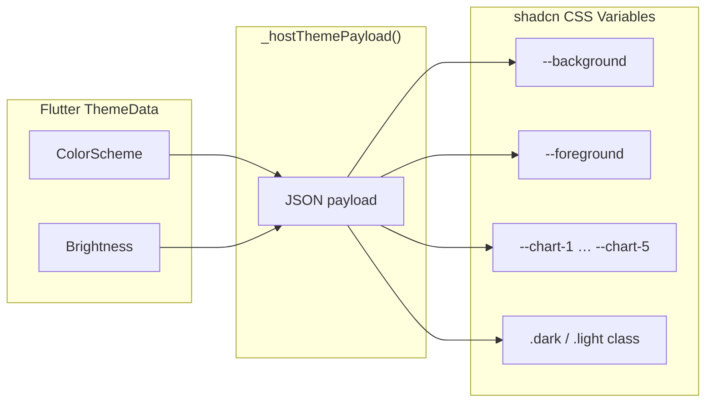
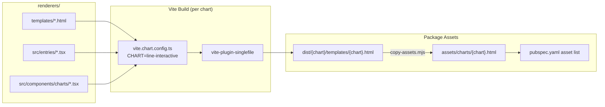
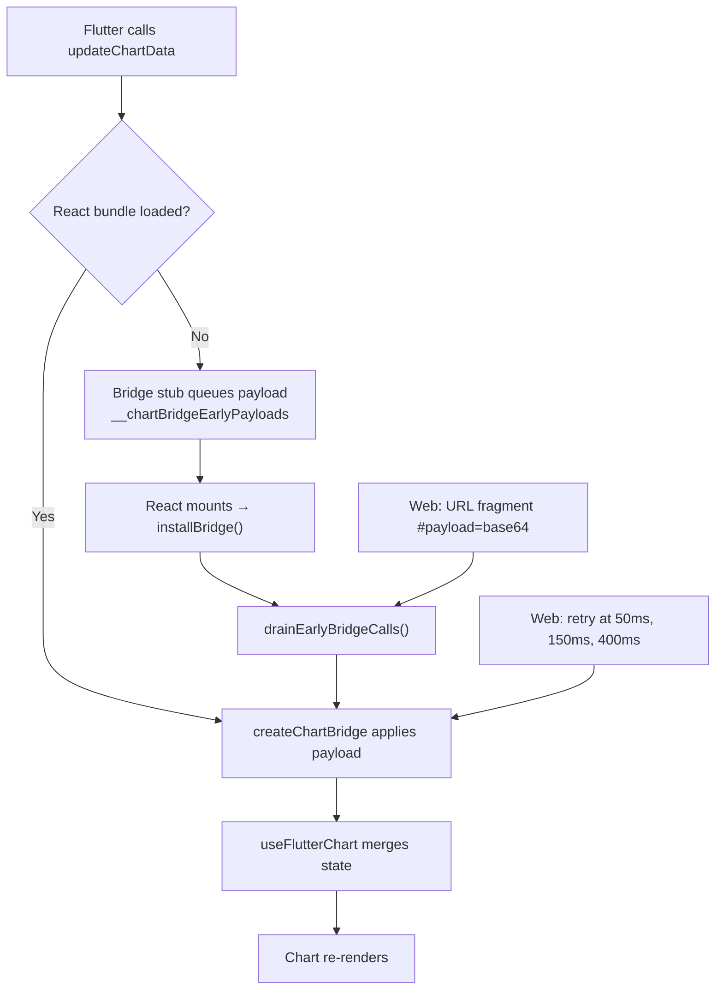
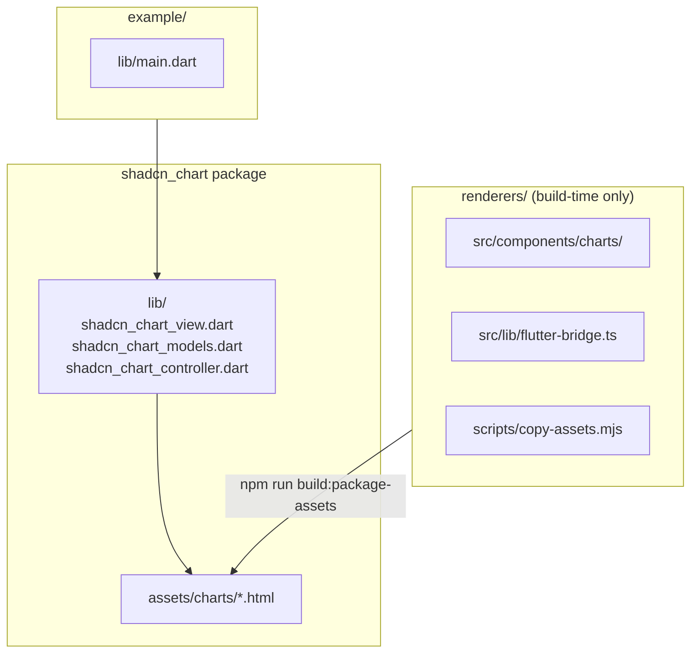

If you've worked with Flutter long enough, you've probably hit the same wall I did: the charting ecosystem is solid, but it rarely matches the polish of modern web dashboards. [shadcn/ui](https://ui.shadcn.com/) charts — built on [Recharts](https://recharts.org/) — look great out of the box: interactive tooltips, clean cards, time-range selectors, and a design language that fits today's SaaS UIs.

I wanted that look and feel inside Flutter apps — without shipping a separate web app or depending on a live CDN at runtime.

That's how [**shadcn_chart**](https://github.com/balajimalathi/shadcn-chart) came to be: a Flutter package that renders shadcn/Recharts charts through an embedded WebView, driven by a typed Dart API, with all HTML bundled as package assets.

> **Screenshot placeholder:** shadcn_chart example app — light and dark themes
> **Note:** Hero — side-by-side light and dark theme charts from the example app
> **File:** `PLACEHOLDER_SCREENSHOT_HERO_LIGHT_DARK.png`
> **Caption:** The example app on Android in light and dark themes.

---

## The problem I was trying to solve

Flutter has capable chart libraries (`fl_chart`, `syncfusion_flutter_charts`, and others), but they don't replicate the shadcn/ui chart experience:

- Card layouts with title, description, and footer
- Interactive series toggles in the header
- Time-range selectors on area charts
- Tooltip and legend styling that matches shadcn's design tokens

Rebuilding all of that in pure Flutter would be a large, ongoing maintenance burden. shadcn charts are already battle-tested React components. The pragmatic question became: **how do I embed them in Flutter without making the developer experience painful?**

My constraints:

1. **No network at runtime** — charts must work offline and in production without external script tags.
2. **A native Flutter API** — developers shouldn't write JSON by hand or manage WebView plumbing themselves.
3. **Theme consistency** — charts should respect the host app's light/dark `ThemeData`.
4. **Cross-platform** — Android, iOS, macOS, Windows, and Web.

---

## The architecture at a glance

The package is a **hybrid bridge**: Flutter owns layout, navigation, state, and theming; the web stack owns chart rendering fidelity.



### Data flow

When you pass chart data to `ShadcnChartView`, this is what happens end to end:



---

## Layer 1: A typed Dart API

Instead of passing raw maps, every chart has a dedicated Dart class that serializes to the JSON shape the React renderer expects.

For example, an interactive line chart:

```dart
ShadcnChartView(
  data: InteractiveLineChartData(
    title: 'Visitors',
    description: 'Last 7 days',
    activeSeriesKey: 'desktop',
    series: const [
      ChartSeries(key: 'desktop', label: 'Desktop', color: Colors.teal),
      ChartSeries(key: 'mobile', label: 'Mobile', color: Colors.deepOrange),
    ],
    data: [
      TimeSeriesPoint(
        date: DateTime(2026, 6, 1),
        values: const {'desktop': 120, 'mobile': 98},
      ),
      // ...
    ],
  ),
)
```

Each model implements `toJson()` and declares its chart type via `ShadcnChartType`, which maps to a bundled HTML asset:

| Chart | Dart type | Asset |
|-------|-----------|-------|
| Interactive area | `AreaChartData` | `area-interactive.html` |
| Interactive bar | `InteractiveBarChartData` | `bar-interactive.html` |
| Multiple bar | `MultipleBarChartData` | `bar-multiple.html` |
| Interactive line | `InteractiveLineChartData` | `line-interactive.html` |
| Donut pie | `PieDonutChartData` | `pie-donut.html` |
| Legend pie | `PieLegendChartData` | `pie-legend.html` |
| Stacked radial | `RadialStackedChartData` | `radial-stacked.html` |

Shared primitives — `ChartSeries`, `TimeSeriesPoint`, `CategorySeriesPoint`, `PieChartSegment` — keep the API consistent across chart types.

> **Screenshot placeholder:** Typed Dart API next to rendered chart
> **Note:** Code + rendered chart side by side
> **File:** `PLACEHOLDER_SCREENSHOT_DART_API.png`
> **Caption:** a screenshot showing Dart code alongside the rendered chart in the example app.

---

## Layer 2: `ShadcnChartView` — the WebView host

`ShadcnChartView` is the main widget. It:

1. Loads the correct bundled HTML for the chart type
2. Embeds it in an `InAppWebView` with scroll/zoom disabled so it feels like a native surface
3. Pushes initial data and theme on load
4. Re-syncs when Flutter `Theme` changes

On native platforms, HTML is loaded from package assets:

```dart
Future<String> _loadChartHtml() {
  return rootBundle.loadString(widget.data.type.packageAssetKey);
}
```

On web, it loads the asset URL and passes the initial payload via a URL fragment (base64-encoded JSON), because iframe timing differs from native WebViews.

WebView settings are tuned so the chart doesn't behave like a nested browser:

- Transparent background
- Scrolling disabled
- Context menu disabled
- Zoom disabled

The widget also maps Flutter's `ColorScheme` to shadcn CSS variables (`--background`, `--foreground`, `--chart-1`, etc.) so charts automatically follow Material 3 light/dark themes.



---

## Layer 3: Runtime updates with `ShadcnChartController`

Rebuilding the WebView on every data change would be expensive. Instead, `ShadcnChartController` calls JavaScript directly:

```dart
final controller = ShadcnChartController();

ShadcnChartView(
  controller: controller,
  data: initialChartData,
);

// Later, without rebuilding the widget:
await controller.updateData(nextChartData);
```

The controller queues scripts if they're fired before the WebView attaches, then flushes them on `attach`. That avoids race conditions during initial load.

> **Screenshot placeholder:** Runtime data refresh via ShadcnChartController
> **Note:** Example app with Refresh FAB showing updated values
> **File:** `PLACEHOLDER_SCREENSHOT_RUNTIME_UPDATE.png`
> **Caption:** a before/after or GIF of the example app's "Refresh data" button updating chart values.

---

## Layer 4: Building self-contained HTML renderers

The React source lives in `renderers/`. Each chart is a Vite entry that compiles to a **single HTML file** — JavaScript, CSS, and markup inlined — using `vite-plugin-singlefile`.



The build is parameterized per chart:

```bash
cross-env CHART=line-interactive vite build --config vite.chart.config.ts
```

After building all seven charts, a copy script moves them into `assets/charts/` for Flutter packaging:

```bash
cd renderers
npm install
npm run build:package-assets
```

This pipeline matters because:

- **No CDN** — everything ships inside the Flutter package
- **One file per chart** — simple asset loading, no relative path issues in WebView
- **Independent bundles** — you only load the chart you need

Each chart component uses a React hook, `useFlutterChart`, that subscribes to bridge updates and merges incoming payloads into local state.

---

## Layer 5: The JavaScript bridge

The bridge exposes two global functions Flutter can call:

- `window.updateChartData(json)` — push new chart data
- `window.setHostTheme(json)` — apply Flutter theme as CSS variables

On the React side, `useFlutterChart` subscribes to a pub/sub bridge (`createChartBridge` in `flutter-bridge-core.ts`). When Flutter sends a partial update, it merges into the current payload rather than replacing everything — useful for updating just `data` while keeping `title` and `series` intact.

Theme application maps Flutter colors directly to shadcn CSS custom properties:

```typescript
root.classList.toggle("dark", theme.brightness === "dark")
root.style.setProperty("--primary", theme.primary)
root.style.setProperty("--chart-1", theme.chart1)
// ...
```

No separate React theme provider — the host Flutter theme *is* the chart theme.

---

## The hardest problem: the load race

The trickiest bug to solve was timing.

Flutter can call `evaluateJavascript` as soon as the WebView reports `onLoadStop`. But the React bundle might not have installed `window.updateChartData` yet. Early calls were silently lost.

I solved this in four layers:



### 1. Bridge stub in HTML `<head>`

Before React loads, a tiny inline script defines stub functions that queue payloads:

```html
<script>
window.updateChartData = function(data) {
  (window.__chartBridgeEarlyPayloads ||= []).push(
    typeof data === "string" ? JSON.parse(data) : data
  );
};
</script>
```

### 2. Drain early calls when React mounts

When the real bridge installs, it processes any queued payloads and themes before subscribing listeners.

### 3. Web-specific retries

On Flutter Web, iframes can finish navigation before the bridge is ready. `ShadcnChartView` retries the initial payload at 50ms, 150ms, and 400ms so the first dataset isn't dropped.

### 4. URL fragment payload (web only)

For web, initial data can also be encoded in the URL hash (`#payload=<base64>`), so the chart can render before the first `evaluateJavascript` call.

This early-payload system is covered by unit tests in `flutter-bridge-core.test.ts` — important for a bridge that's easy to break silently.

---

## Making charts feel native inside Flutter

A WebView chart can feel "webby" if you're not careful. A few details help:

**Wheel event forwarding** — On web, scroll events inside the iframe are forwarded to the parent so a chart inside a `ListView` doesn't trap scrolling.

**Responsive sizing** — Recharts `ResponsiveContainer` fills the WebView bounds; Flutter controls size via `SizedBox` or `AspectRatio`.

**Optional text fields** — Titles, descriptions, and footers are omitted from JSON when not set, and the renderer hides the corresponding UI. No empty card headers.

**Color conversion** — Flutter `Color` values are serialized to CSS hex (including alpha when needed), so you can pass `Colors.teal` directly on series or segments.

---

## All seven chart types

The example app demonstrates every chart type in a scrollable list:

> **Screenshot placeholder:** Example app showing all seven chart types
> **Note:** Full example app scroll — all chart types
> **File:** `PLACEHOLDER_SCREENSHOT_ALL_CHARTS.png`
> **Caption:** Tall screenshot or stitched image of the example app ListView.

### Interactive line

> **Screenshot placeholder:** Interactive line chart
> **File:** `PLACEHOLDER_SCREENSHOT_LINE_INTERACTIVE.png`

### Interactive bar

> **Screenshot placeholder:** Interactive bar chart
> **File:** `PLACEHOLDER_SCREENSHOT_BAR_INTERACTIVE.png`

### Interactive area (with time-range selector)

> **Screenshot placeholder:** Interactive area chart
> **File:** `PLACEHOLDER_SCREENSHOT_AREA_INTERACTIVE.png`

### Multiple bar

> **Screenshot placeholder:** Multiple bar chart
> **File:** `PLACEHOLDER_SCREENSHOT_BAR_MULTIPLE.png`

### Donut pie

> **Screenshot placeholder:** Donut pie chart
> **File:** `PLACEHOLDER_SCREENSHOT_PIE_DONUT.png`

### Legend pie

> **Screenshot placeholder:** Legend pie chart
> **File:** `PLACEHOLDER_SCREENSHOT_PIE_LEGEND.png`

### Stacked radial

> **Screenshot placeholder:** Stacked radial chart
> **File:** `PLACEHOLDER_SCREENSHOT_RADIAL_STACKED.png`

---

## What the developer experience looks like

Minimal usage:

```dart
SizedBox(
  height: 320,
  child: ShadcnChartView(
    data: InteractiveLineChartData(
      title: 'Visitors',
      series: series,
      data: points,
    ),
  ),
)
```

Live updates:

```dart
await controller.updateData(updatedChartData);
```

Theme switching — flip `ThemeMode` in your `MaterialApp`; charts pick up new colors on the next frame via `didChangeDependencies`.

---

## Trade-offs I accepted

This approach isn't free. Worth knowing upfront:

| Pros | Cons |
|------|------|
| Pixel-accurate shadcn/Recharts UI | WebView overhead per chart |
| Rich interactivity without reimplementing in Flutter | Depends on `flutter_inappwebview` platform setup |
| Offline, bundled assets | Larger package size (7 HTML bundles) |
| Typed Dart API | Not ideal for hundreds of simultaneous charts |

For dashboard screens with a handful of charts, the trade-off is favorable. For real-time trading terminals with dozens of live charts, a native Flutter chart library is probably a better fit.

---

## Project structure



---

## How I'd extend it

The architecture makes a few extensions straightforward:

- **New chart types** — Add a React component, Vite entry, HTML template, Dart model, and asset entry in `pubspec.yaml`
- **Bidirectional events** — `addJavaScriptHandler` could report series selection back to Flutter
- **Custom formatters** — Extend the JSON schema with label formatter hints

The bridge pattern is the core abstraction; individual charts are mostly independent.

---

## Try it yourself

Install from pub.dev:

```yaml
dependencies:
  shadcn_chart: ^0.1.0
```

Run the example:

```bash
cd example
flutter pub get
flutter run
```

Source and issues: [github.com/balajimalathi/shadcn-chart](https://github.com/balajimalathi/shadcn-chart)

---

## Closing thoughts

Sometimes the best Flutter package isn't pure Flutter. `shadcn_chart` embraces a hybrid model: **Flutter owns layout, navigation, state, and theming; the web stack owns chart rendering fidelity.**

The real engineering work wasn't wrapping a WebView — it was making the bridge reliable (early payloads, theme sync, scroll forwarding), the API typed and ergonomic, and the build pipeline produce offline-ready single-file bundles.

If you've been wishing your Flutter dashboards looked like your Next.js admin panel, this might be the shortcut you're looking for.
