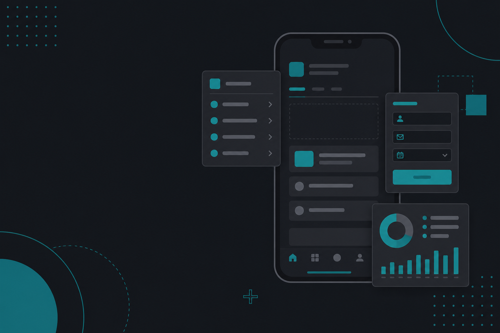
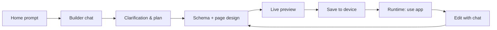
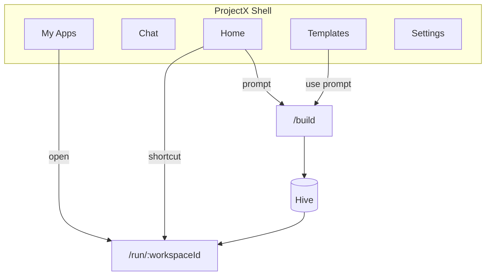
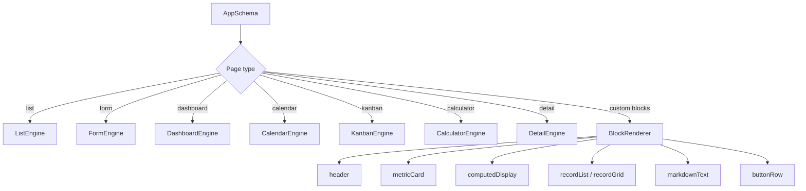
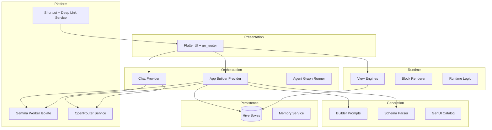
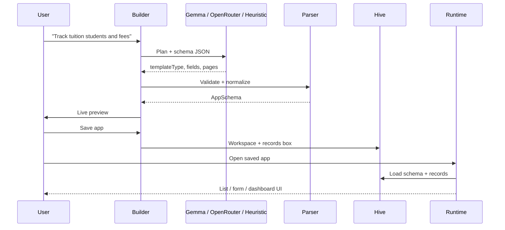
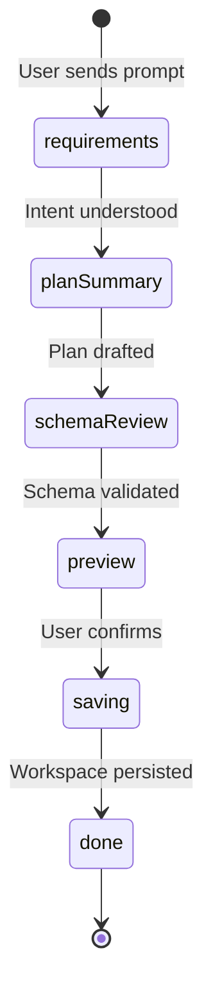
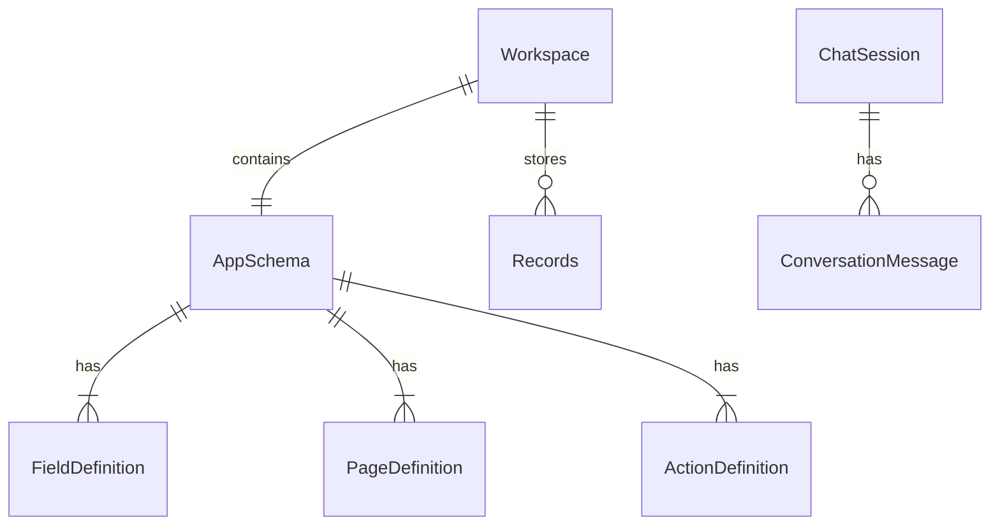
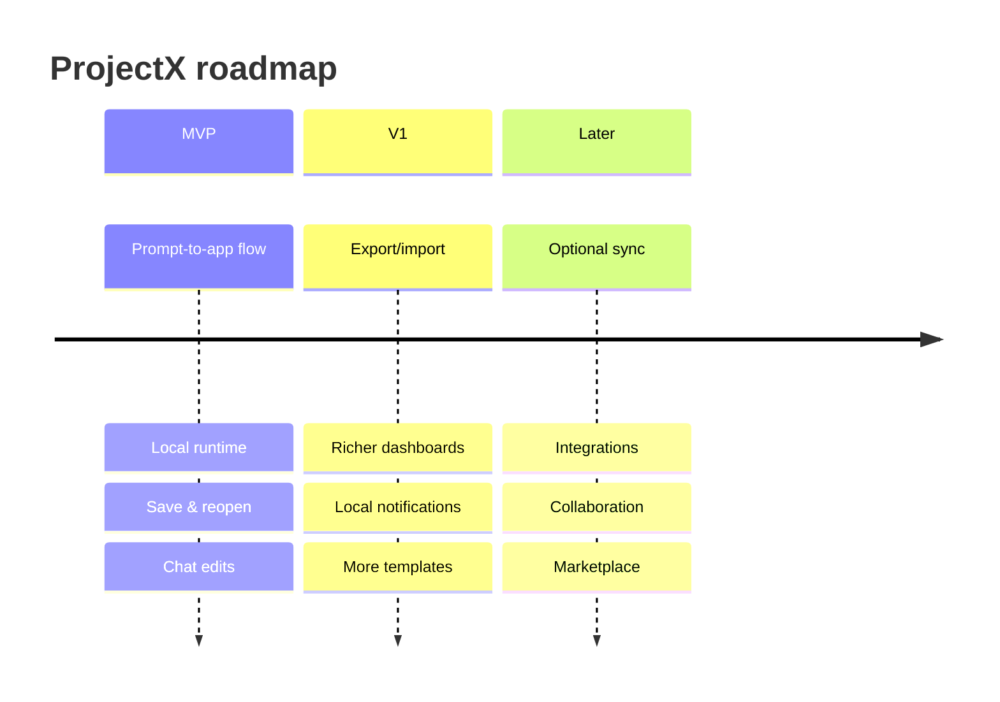

## TL;DR

ProjectX is a Flutter mobile app that lets users describe a small personal tool in plain English, preview it, save it on-device, and refine it later through chat. Instead of generating arbitrary Flutter source code, it produces a **constrained app schema** that a dedicated **runtime engine** renders into lists, forms, dashboards, calendars, kanban boards, and calculators.

The result feels less like a no-code studio and more like a **personal app concierge** — fast, local-first, and trustworthy.

---

## The problem: builders overwhelm, templates underwhelm

Most people who say "I wish I had an app for this" do not want:

- A canvas full of widgets
- A schema editor
- A login wall before they can try anything
- A web-only prototype that disappears when connectivity drops

They want a **finished tool** that matches their goal: track students, plan revision, manage contacts, run a simple calculator workflow.

Traditional approaches sit at two extremes:

| Approach | Strength | Weakness |
|----------|----------|----------|
| No-code builders | Flexible | High cognitive load; feels like work |
| Fixed templates | Fast | Too generic; hard to personalize |
| AI code generation | Impressive demos | Brittle, unsafe, hard to maintain on mobile |

ProjectX targets the gap: **guided creation + personalized output + on-device persistence**.

> **Screenshot placeholder:** Side-by-side comparison — generic no-code builder UI vs. ProjectX home prompt screen  
> **File:** `assets/blog/01-problem-vs-projectx-home.png`  
> **Caption:** ProjectX leads with a goal-first prompt, not a builder canvas.

---

## The product bet: concierge, not studio

The core UX principles:

1. **Goal-first, not feature-first** — "What should this app help you manage?"
2. **One primary action per screen** — avoid builder-style overwhelm
3. **Local-first trust** — your app is ready on this device
4. **Conversational refinement** — change the app by chatting, not by editing JSON
5. **Saved workspaces feel like "my app"** — not a generated artifact

### Primary user flow



> **Screenshot placeholder:** End-to-end flow montage (4-panel)  
> **File:** `assets/blog/02-user-flow-montage.png`  
> **Panels:** Home → Builder → Preview → Runtime

---

## What ProjectX ships today

### Shell navigation

Five top-level areas mirror the product IA:

- **Home** — prompt composer, pinned apps, recents
- **Chat** — general assistant sessions with memory
- **My Apps** — library of saved workspaces
- **Templates** — starter prompts
- **Settings** — profile, model preferences, storage, privacy



> **Screenshot placeholder:** Bottom navigation with five tabs  
> **File:** `assets/blog/03-shell-navigation.png`

### Supported app types

The builder targets constrained templates:

| Template | Typical use |
|----------|-------------|
| Tracker | Fees, attendance, habits |
| Planner | Tasks, schedules |
| CRM-lite | Contacts, follow-ups |
| Notes | Quick capture lists |
| Study planner | Revision targets |
| Calculator | Formula-driven tools |

Each saved app gets an `AppSchema`: fields, enabled views, page definitions, and optional actions.

### Runtime surfaces

The runtime does not execute generated Dart source. It reads the schema and dispatches to engines:



> **Screenshot placeholder:** Runtime app showing list view with FAB  
> **File:** `assets/blog/04-runtime-list.png`

> **Screenshot placeholder:** Dashboard with metric cards  
> **File:** `assets/blog/05-runtime-dashboard.png`

> **Screenshot placeholder:** Calculator engine with computed fields  
> **File:** `assets/blog/06-runtime-calculator.png`

---

## Architecture: six layers, one promise

The implementation follows a layered model:



### Why schema-driven beats code generation (for v1)

On mobile, generating executable Flutter code on-device is risky:

- Hard to sandbox
- Breaks across Flutter SDK updates
- Difficult to migrate user data when the "app" changes
- Unpredictable UX

A schema-driven approach trades unlimited flexibility for **reliability**:



The user still gets the magic — **"your app is ready"** — while the engineering stays maintainable.

---

## Builder pipeline: from prompt to preview

The app builder moves through explicit stages:



**Stage labels shown in the UI:**

1. Understanding your idea…
2. Summarizing the app…
3. Designing your schema…
4. Designing pages…
5. Saving…

The builder provider orchestrates messages, build-step timeline, schema state, and fallback behavior when no AI model is available.

> **Screenshot placeholder:** Builder chat with stage banner and build-step timeline  
> **File:** `assets/blog/07-builder-stages.png`

> **Screenshot placeholder:** Schema review with editable title/icon and page preview  
> **File:** `assets/blog/08-builder-preview.png`

### AI strategy: on-device first, cloud optional, heuristics always

| Mode | When used |
|------|-----------|
| **Gemma (isolate worker)** | On-device planning when a model is installed |
| **OpenRouter** | Optional cloud models (API key in secure storage) |
| **Heuristic fallback** | Keyword/template inference when AI is unavailable |

Gemma runs in a **background isolate** so inference does not block the UI thread. The `ModelClient` abstraction lets builder and chat code swap providers without rewriting orchestration logic.

> **Screenshot placeholder:** Settings screen — Gemma status, model import, OpenRouter key  
> **File:** `assets/blog/09-settings-models.png`

---

## GenUI: conversational surfaces without losing control

[GenUI](https://pub.dev/packages/genui) provides catalog-based interactive surfaces for clarification and setup. ProjectX wraps it behind a project-specific catalog with guardrails:

- Prefer concise template/field selection surfaces
- No external APIs or arbitrary code in generated apps
- Keep output schema-driven

GenUI is treated as a **rendering adapter**, not the source of truth. The durable state lives in Hive as `Workspace` and `AppSchema` objects.

---

## Persistence: Hive and local trust

Workspaces, records, chat sessions, and builder drafts persist on-device via Hive.



Privacy messaging is explicit in Settings:

- Generated app definitions, records, and patch history stay local
- If Gemma is installed, prompt understanding can also run on-device

> **Screenshot placeholder:** My Apps library with pin, archive, and open actions  
> **File:** `assets/blog/10-my-apps-library.png`

---

## Platform touches: shortcuts and deep links

On Android, saved apps can sync to **home-screen shortcuts**. Launches resolve through deep links:

```
projectx://run/{workspaceId}
```

`go_router` redirects incoming URIs to `/run/:workspaceId`, so a shortcut feels like opening a standalone app — while still living inside the ProjectX shell.

> **Screenshot placeholder:** Android home screen with ProjectX app shortcuts  
> **File:** `assets/blog/11-android-shortcuts.png`

---

## Tech stack

| Layer | Choice |
|-------|--------|
| Framework | Flutter (Dart ^3.12) |
| State | Riverpod |
| Routing | go_router |
| Storage | Hive |
| On-device AI | flutter_gemma + LiteRT-LM (isolate worker) |
| Cloud AI (optional) | OpenRouter |
| Conversational UI | GenUI |
| Typography | google_fonts (Inter) |
| Security | flutter_secure_storage (API keys) |

### Project structure

```
lib/
├── app.dart                 # Router + shell
├── main.dart                # Bootstrap
├── core/
│   ├── agent/               # Agent graph + checkpointer
│   ├── models/              # Workspace, chat, messages
│   ├── providers/           # Riverpod providers
│   └── services/            # Gemma, Hive, shortcuts, OpenRouter
├── features/
│   ├── home/
│   ├── chat/
│   ├── app_builder/
│   ├── app_runtime/
│   ├── my_apps/
│   ├── templates/
│   └── settings/
└── shared_ui/
```

---

## Design details that matter

### Copy style

Microcopy sounds like a helpful operator:

- "What do you want this app to help you manage?"
- "Your first version is ready."
- "Tell us what to change, and this app will update."

Avoid: schema, entity, CRUD, builder, component.

### Visual direction

- Calm neutral base with teal accent (`#0E7C86`)
- Rounded cards, large tap targets
- Light and dark mode from day one
- No "futuristic AI" aesthetic — practical and reassuring

> **Screenshot placeholder:** Dark mode runtime view  
> **File:** `assets/blog/12-dark-mode.png`

---

## What we deliberately excluded (MVP)

- Multi-user collaboration
- Cloud sync
- External API integrations inside generated apps
- Public template marketplace
- Arbitrary plugin ecosystem
- Desktop/web targets

These are planned for later phases. The MVP optimizes for **solo operators, students, and creators** who need a personal workflow app fast.



---

## Lessons learned

### 1. Constrain the output format early

Letting the model invent anything produces pretty demos and fragile products. A fixed schema with a small set of engines makes iteration predictable.

### 2. Always ship a non-AI path

Heuristic template matching means the app works on first install — no model download required. That is critical for onboarding and trust.

### 3. Isolate heavy inference

On-device LLMs belong off the UI thread. A dedicated Gemma worker isolate keeps scrolling and typing responsive.

### 4. Make "saved app" feel native

Shortcuts and deep links bridge the gap between "app inside an app" and "this is my tuition tracker."

### 5. GenUI is powerful but alpha — wrap it

Treat conversational UI as an adapter layer. Your domain models and persistence should not depend on GenUI internals.

---

## Try it yourself

```bash
flutter pub get
flutter run
flutter test
```

Optional: install a Gemma model in **Settings → Offline Gemma** to enable on-device app planning.

---

## Closing thought

The most interesting mobile products in the AI era may not be chatbots with extra tabs. They may be **intent engines** that hand users a durable tool — one that respects privacy, works offline, and improves through conversation.

ProjectX is our experiment in that direction: **less builder, more utility.**

---
